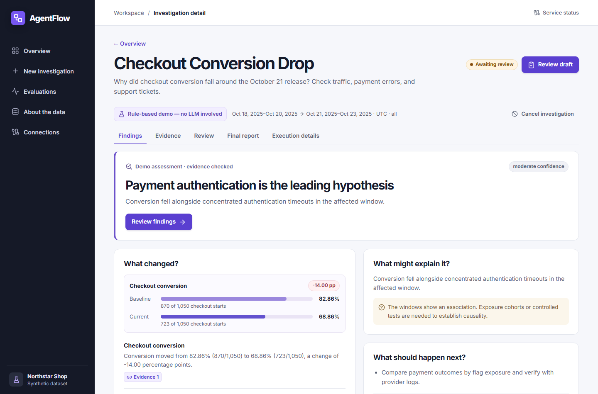
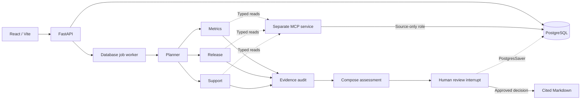

# AgentFlow

AgentFlow investigates incidents at a fictional retailer, checks the evidence, and prepares a cited report for human review.


## Try it locally

Start Docker Desktop with Linux containers, then run these PowerShell commands from the repository root. The first build downloads packages and container images.

```powershell
if (-not (Test-Path .env)) { Copy-Item .env.example .env }
./scripts/doctor.ps1
./scripts/demo.ps1
./scripts/verify.ps1
```

Open the [workspace](http://127.0.0.1:3001), [API documentation](http://127.0.0.1:8001/docs), or [service readiness](http://127.0.0.1:8001/readyz). The independent MCP endpoint is `http://127.0.0.1:8002/mcp`. Bash entry points are `bash scripts/demo.sh` and `bash scripts/verify.sh`.

## What you will see

Northstar Shop is a fictional retailer with website and mobile shoppers. Every checkout, payment, deployment, and support record is synthetic and reproducible. The **About the data** page explains how those records fit together.

Click **Try demo: Checkout Conversion Drop**. AgentFlow opens three plain-language views of the findings.

- **What changed?** Audited before-and-after figures with source links.
- **What might explain it?** An evidence-based hypothesis with uncertainty.
- **What should happen next?** Follow-up actions and unresolved questions.

Open **Execution details** for the actual agent graph and tool trace. Review the draft, approve it, and download Markdown. A persisted checkpoint lets the review continue after an API restart.



## Demo and model modes

The free demo uses explicit rules and displays **Rule-based demo — no LLM involved**. It exercises the same graph, MCP transport, verification, checkpoints, and approvals.

Optional live inference supports local Ollama, OpenAI, and Anthropic Claude. Live specialists analyze evidence and choose bounded follow-up checks. The model composes competing explanations with supporting and contradictory sources, uncertainty, and next actions. Python computes the numerical observations and checks scope and citations. Configure provider keys and model IDs on the server using the [model setup guide](docs/MODELS.md).

The benchmark compares sequential and parallel investigations on twelve development cases and three held-out cases with independent reference counts. **Evaluations** shows actual checks, timing, tool calls, and provider-reported tokens when available. Reference labels are project-authored and await independent human review.

## Recruiter hosting

The [Render hosting guide](docs/HOSTING.md) covers a free web service and an external free PostgreSQL database. The repository includes the Render blueprint, a single-container deployment build, and a verification script for separate visitor sessions. The free service can sleep between visits.

Preview the exact hosting container locally.

```powershell
docker compose -f compose.yml -f compose.hosted.yml --profile hosted up --build -d --wait recruiter
python scripts/verify-public.py
```

Open the [recruiter preview](http://127.0.0.1:3011). This public mode scopes each browser's investigations and approvals to its visitor session. Paid inference runs are available in the owner workspace.

## Architecture



The stack uses FastAPI, Pydantic, SQLAlchemy, PostgreSQL, LangGraph, the official MCP Python SDK, and React with TypeScript. It runs one scheduler per database. Demo statistics describe small synthetic fixtures. Model conclusions require review, and causal attribution needs exposure data or controlled tests.

- [Two-minute demo](docs/DEMO.md)
- [Architecture](docs/ARCHITECTURE.md), [API contract](docs/API.md), and [debugging guide](docs/DEBUGGING.md)
- [Data dictionary](data/README.md) and [evaluation procedure](eval/README.md)
- [Security](docs/SECURITY.md) and [local deployment](docs/DEPLOYMENT.md)
- [Executed verification](docs/VERIFICATION.md), [engineering walkthrough](docs/ENGINEERING.md), and [resume notes](docs/RESUME_NOTES.md)
