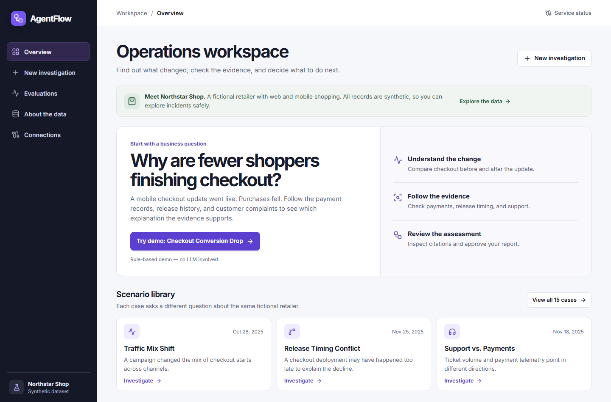
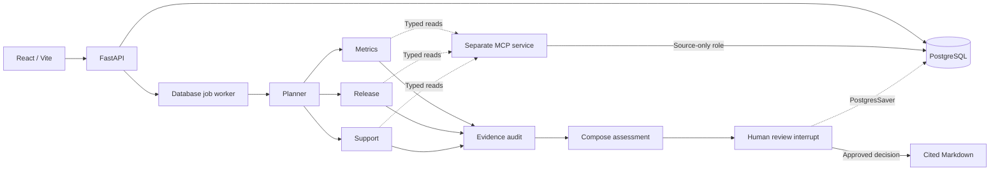

# AgentFlow

AgentFlow is an operations investigation workspace for retail incidents. It coordinates specialists that examine checkout metrics, payment errors, release history, and support trends. Each investigation produces a source-linked assessment for human review.

[Open AgentFlow](https://agentflow-ho1a.onrender.com)

[Watch the 2:43 AgentFlow walkthrough](https://drive.google.com/file/d/1KjOO-RhE7xqKAVVSHlzPKJ_egUECEOGR/view?usp=sharing). The captioned video follows a synthetic checkout incident through evidence review, approval, and report export.



## Investigate an incident

Start with **Checkout Conversion Drop** or choose a case from the scenario library. The hosted workspace uses OpenAI by default and also supports Claude. Each browser session has its own investigations and review history.

- **Findings** shows what changed, competing explanations, and recommended next steps.
- **Evidence** links metrics and claims to individual source records.
- **Execution details** shows the LangGraph workflow, MCP tool calls, and verification events.
- **Review** lets you approve, reject, or request a revision. Approval unlocks a Markdown export.

Northstar Shop is fictional. The dataset contains reproducible synthetic checkout, payment, deployment, and support records. **About the data** explains how the records fit together.


## Run locally

Start Docker Desktop with Linux containers. From the repository root, run:

```powershell
if (-not (Test-Path .env)) { Copy-Item .env.example .env }
./scripts/demo.ps1
```

Open the [local workspace](http://127.0.0.1:3001). Local startup uses the rule-based mode so you can exercise the full workflow without credentials. To use OpenAI, Claude, or Ollama locally, see [model configuration](docs/MODELS.md). Run `./scripts/verify.ps1` for the full verification suite or use `bash scripts/demo.sh` and `bash scripts/verify.sh` on Bash.

## Architecture



The stack uses React and TypeScript, FastAPI, PostgreSQL, LangGraph, and the official MCP Python SDK. The workflow audits numerical observations against source records and persists the review checkpoint in PostgreSQL. LangGraph can resume a review after an API restart.

The [evaluation suite](eval/README.md) compares sequential and parallel investigations on 12 development cases and three held-out cases. Reports track deterministic checks, execution time, tool calls, and provider-reported tokens when available.

## Deployment and operations

The hosted app runs on Render with external PostgreSQL. The repository includes the Render Blueprint, container build, and checks for deployment health, visitor isolation, and approval-gated exports.

- [Render deployment](docs/HOSTING.md) and [model configuration](docs/MODELS.md)
- [Investigation walkthrough](docs/DEMO.md) and [data dictionary](data/README.md)
- [Architecture](docs/ARCHITECTURE.md), [API contract](docs/API.md), and [engineering notes](docs/ENGINEERING.md)
- [Security](docs/SECURITY.md), [troubleshooting](docs/DEBUGGING.md), and [verification results](docs/VERIFICATION.md)
