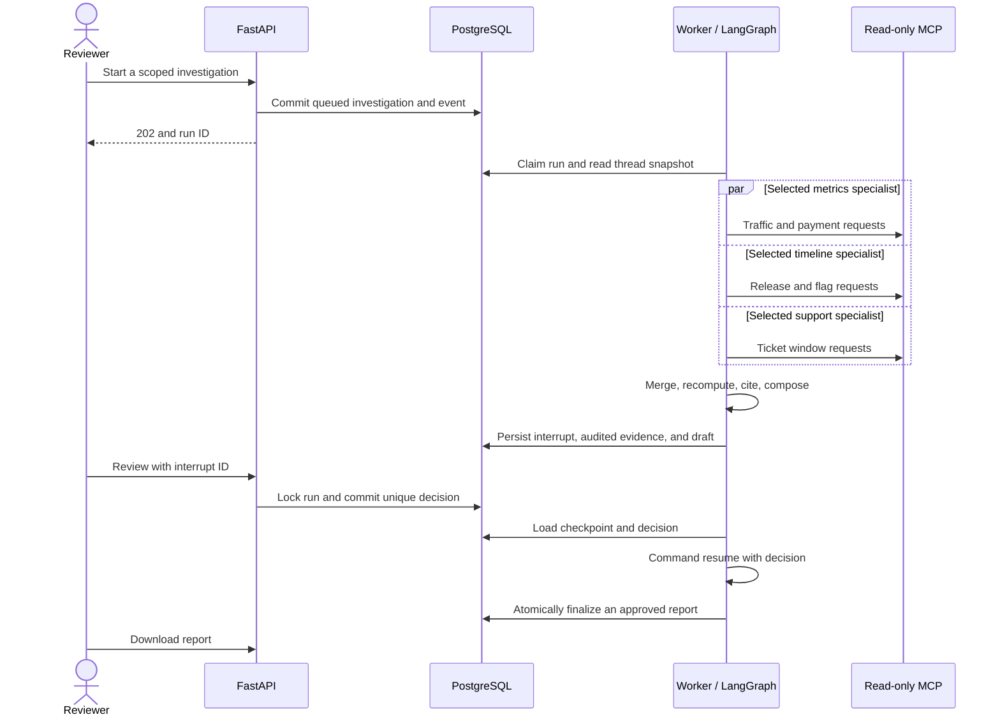

# Architecture

## Components

- Nginx serves the compiled Vite app and proxies its same-origin API calls. Browser requests poll persisted progress. No provider credentials reach React.
- FastAPI validates inputs and enqueues investigations, review decisions, experiments, and judge calibration in PostgreSQL. SQLAlchemy handles application persistence. The API process hosts one scheduler, protected by a PostgreSQL session advisory lock.
- The LangGraph workflow uses synchronous checkpoints in a dedicated schema. Each investigation has a unique thread ID. The PostgresSaver migrations run during bootstrap.
- The MCP server uses the official Python SDK and stateless Streamable HTTP. Its PostgreSQL login can read the Northstar source tables. Investigation data is outside that role's grants.
- The model adapters send bounded structured requests directly to local Ollama or fixed official OpenAI and Anthropic endpoints. The single-container Render image serves the web app, API, and a separate loopback MCP process. Optional LangSmith export uses the official SDK and sends allowlisted metadata.

## Investigation and review

The planner resolves the question to an allowlisted set of domains using a selected case's UTC scope. The deterministic planner uses explicit rules. In Ollama mode the model selects a typed route. Branches return disjoint evidence keys through a LangGraph reducer. The next superstep audits the merged set once. Model-assisted specialists write qualitative assessments and alternatives, select at most one follow-up recipe per domain, and inspect the result. Python maps recipes to fixed MCP requests. The composer ranks competing explanations, cites supporting and contradictory evidence, and writes uncertainty and next steps. Counts, windows, citations and causal caveats stay code-controlled.

## State and recovery

`queued → running → awaiting_review → review_queued → reviewing → approved/rejected` is the ordinary path. A revision re-audits the retained evidence, narrows confidence, and parks at a new interrupt. Failed demands return a terminal error, and unsupported questions can request clarification. Cancellation is cooperative. A bounded remote call that has already started can finish, while the canceled run remains ineligible for finalization.

The worker claims one item at a time. During an API restart PostgreSQL releases the scheduler lock. The next worker can continue at the saved checkpoint, apply a recorded decision, or reconcile graph state into the application tables. Review acceptance holds a row lock and enforces uniqueness by run and round plus interrupt ID. The interrupt node keeps side effects outside its body because LangGraph re-enters that node on resume. Approved output references the approving ledger row and commits with the terminal status.

Trace inserts serialize per run with state changes so a high-water cursor cannot miss a lower ID that commits later. Worker recovery may repeat reads or calls around a crash boundary. Reports use one unique database row and explicit state checks to bound side effects. Benchmarks and calibrations commit progress per case.

## Limits and failure modes

- A database queue shares one runtime with the API. An active benchmark case or slow model call can delay an investigation. There is no horizontal scheduling or durable multi-region delivery.
- Loss of PostgreSQL prevents reads, writes, and checkpointing. With a running database and unavailable MCP server, readiness degrades and affected investigations fail after a bounded retry. The database volume is the durability boundary.
- The local API and MCP use fixed host and origin boundaries. The recruiter container adds an exact public origin, signed visitor sessions, per-session and network limits, active-job limits, and one-day retention. Paid model modes and new evaluation jobs remain owner operations. Organizational identity and tenant access require a separate deployment design.
- The deterministic case catalog and audit validate traceability and arithmetic. Causality needs stronger design and data coverage. Demo timing depends on the host.

Implementation references include the [LangGraph persistence](https://docs.langchain.com/oss/python/langgraph/persistence) and [interrupt](https://docs.langchain.com/oss/python/langgraph/interrupts) guides, the [official MCP Python SDK](https://github.com/modelcontextprotocol/python-sdk), and [Ollama chat](https://docs.ollama.com/api/chat).
